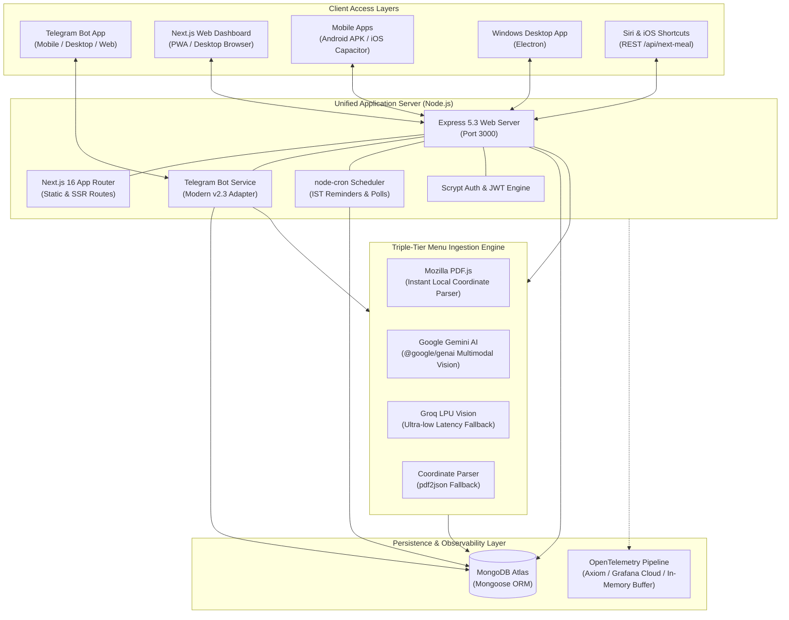
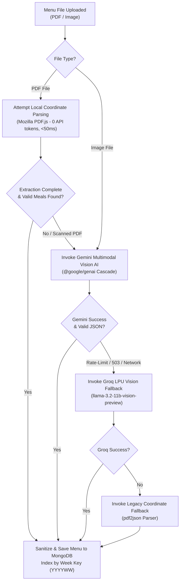
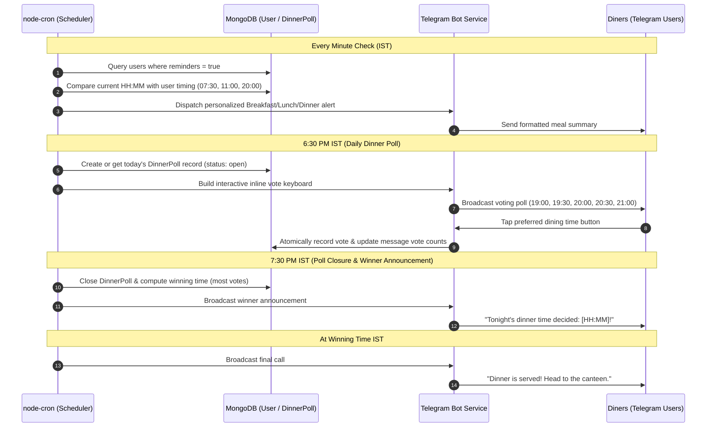

# MasterChef System Architecture Blueprint

## 1. High-Level Architecture Overview

MasterChef is structured as a unified full-stack application that simultaneously hosts an Express REST API, a Next.js App Router front-end, an active Telegram bot polling process, and a resilient background cron scheduler within a single coordinated Node.js process.

---

## 2. Ingestion & Multi-Tier OCR Pipeline

The ingestion engine accepts canteen weekly schedules in PDF or image format (PNG, JPEG, WEBP) from the Web Dashboard or Telegram bot.

---

## 3. Scheduled Cron & Dinner Polling Lifecycle

The system runs a resilient background scheduler strictly calibrated to Indian Standard Time (`Asia/Kolkata`, UTC+5:30).

---

## 4. Telemetry & Observability Pipeline

Telemetry is designed for high-resolution event logging with zero-downtime streaming:
1. **Application Events**: All bot messages, votes, uploads, logins, and errors trigger `logger[severity](action, message, metadata)`.
2. **Telemetry Ingestion**: Events are dispatched to `telemetry.recordEvent()`.
3. **Dual Routing**:
   - **Local In-Memory Ring Buffer**: Retains the last 100 structured events for querying via the web dashboard at `/insights` and `/api/system/logs`.
   - **OpenTelemetry (OTLP) Exporter**: When `OTEL_EXPORTER_OTLP_ENDPOINT` is configured, batches are transmitted via HTTP POST in standard OTLP JSON format to Axiom, Grafana Cloud, or Datadog.
4. **System Metrics**: `/api/system/stats` collects real-time process memory (RSS, Heap, External), CPU utilization, uptime, and database connection metrics.

---

## 5. Security & Defense-in-Depth Architecture

- **Password Verification**: Uses Node.js native `crypto.scryptSync` with a salt and 32-byte key length.
- **Timing Attack Mitigation**: Verifies credentials using `crypto.timingSafeEqual` to prevent side-channel timing analysis.
- **Session Tokens**: Administrative sessions are issued signed JSON Web Tokens (JWT) with a 2-hour expiration window.
- **NoSQL Injection Resistance**: All week keys and user IDs passed to queries are sanitized via strict regular expressions (`/^\d{4,8}$/`).
- **HTTP Header Hardening**: Express utilizes `helmet` to set CSP, HSTS, X-Frame-Options, and X-Content-Type-Options headers.
- **Rate Limiting**: `express-rate-limit` throttles API access to protect against brute-force and DDoS attempts.
- **PDF Execution Mitigation**: `pdfjs-dist` is initialized with `isEvalSupported: false` to eliminate CVE-2024-4367 code execution risks.
