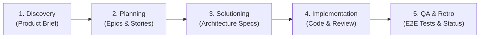

# The BMAD Method: Breakthrough Method for Agile AI Development

## 1. Overview & Purpose
The **BMAD Method** (Breakthrough Method for Agile AI Development) is an AI-native engineering methodology that couples automated agent personas, structured YAML/CSV manifests, and reproducible artifact pipelines to build production-grade software at high velocity.

In **MasterChefInd-bot**, the BMAD Method is integrated to ensure:
- **Architectural Integrity**: Systematic solutioning and context documentation before code changes.
- **Traceable Sprints**: Epics, user stories, and checkpoint previews stored in version-controlled artifact repositories.
- **Specialized Agent Roles**: Predefined roles for development, architecture, code review, and QA testing.

---

## 2. Directory Layout & Artifact Locations

```
bot/
├── _bmad/                              # BMAD Core & Module System
│   ├── _config/                        # System Manifests
│   │   ├── agent-manifest.csv          # Agent definitions, skills, & instructions
│   │   ├── bmad-help.csv               # Help reference for BMAD commands
│   │   ├── files-manifest.csv          # Inventory of managed files & checksums
│   │   ├── manifest.yaml               # Installation version (v6.3.0) & metadata
│   │   └── skill-manifest.csv          # Skill capabilities catalog
│   ├── bmm/                            # Breakthrough Method Module (BMM)
│   │   ├── config.yaml                 # Module settings, languages, artifact roots
│   │   └── module-help.csv             # BMM workflow guide
│   └── core/                           # BMAD Core Engine Configuration
│       ├── config.yaml                 # Core configuration
│       └── module-help.csv             # Core utility commands
├── _bmad-output/                       # Generated Artifact Repository
│   ├── planning-artifacts/             # Architecture designs, product briefs, epics
│   └── implementation-artifacts/       # Sprint status, story files, checkpoint reviews
├── docs/                               # System Documentation & Knowledge Base
└── project-context.md                  # Master project context loaded into AI agents
```

---

## 3. The 4 BMAD Lifecycle Phases



### Phase 1: Discovery & Strategy
- Captures problem statements, user personas, and target outcomes.
- Artifact: `docs/product-brief.md`.

### Phase 2: Planning & Requirement Breakdown
- Decomposes functional pillars into epics, stories, and sprint status logs.
- Artifacts: `_bmad-output/planning-artifacts/epics-and-stories.md`.

### Phase 3: Solutioning & Architecture
- Determines technical feasibility, dependency choices, database schemas, and API contracts.
- Artifacts: `docs/architecture.md`, `project-context.md`.

### Phase 4: Implementation, Checkpoint Previews & QA
- Agents execute story spec files, perform parallel adversarial reviews, and generate automated tests.
- Artifacts: `_bmad-output/implementation-artifacts/`, Jest unit tests (`tests/`).

---

## 4. Key Agent Personas in BMAD
The BMAD system defines specialized agent profiles (stored in `_bmad/_config/agent-manifest.csv`):

| Agent Persona | Role | Key Competencies |
| :--- | :--- | :--- |
| **Amelia (`bmad-agent-dev`)** | Senior Full-Stack Engineer | Story execution, Node.js/Express, Next.js, code implementation. |
| **Architect (`bmad-create-architecture`)** | Principal Solution Architect | Component diagrams, security threat modeling, API design. |
| **Reviewer (`bmad-code-review`)** | Adversarial Hunter | Security vulnerability analysis, edge-case detection, CodeQL compliance. |
| **QA Engineer (`bmad-qa-generate-e2e-tests`)** | Quality Assurance Lead | Automated test harnesses, regression prevention, mock scenarios. |
| **Scrum Master (`bmad-sprint-planning`)** | Agile Coordinator | Sprint status tracking, burndown metrics, risk escalation. |

---

## 5. Integrating BMAD with Antigravity / Coding Agents
When collaborating with AI agents:
1. **Always reference `project-context.md`**: Provides immediate grounding on tech stack, timezone rules, and architectural boundaries.
2. **Consult `docs/architecture.md`**: Ensures new endpoints and database models adhere to design patterns.
3. **Record Changes in `CHANGELOG.md`**: Maintains continuous delivery lineage across version releases.
